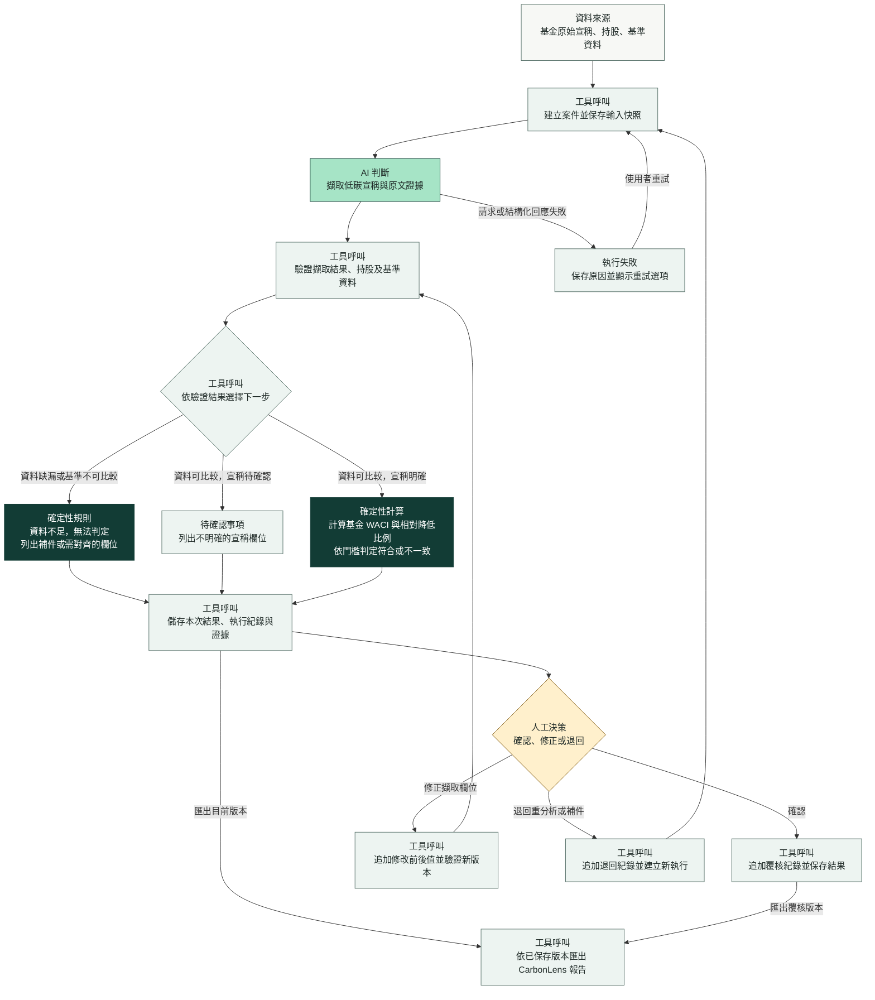

# CarbonLens Agent 工作流程

單一 Agent 依案件狀態執行宣稱擷取、資料驗證與金融計算。OpenAI 模型從原文擷取資訊，Python 程式驗證資料、選擇路徑、計算 WACI 並套用判定規則。下圖描述 Phase 4 與 Phase 5 要實作的流程。

## 宣稱擷取與驗證

模型請求帶入基金原始宣稱，使用結構化欄位回傳宣稱類型、碳強度降低比例、比較基準、適用年度、原文證據與是否需要人工確認。基金 CSV 的 `claimed_reduction_pct` 供合成案例對照。模型請求只使用基金宣稱文字，Python 依案件其他來源驗證結果。

| 欄位 | 驗證與用途 |
| --- | --- |
| 宣稱類型 | 明確識別是否為相對市場基準的碳強度降低宣稱。若文字描述其他指標或缺少比較對象，交由人工確認。 |
| 碳強度降低比例 | 使用百分數欄位，`30` 代表 30%。文字沒有明確比例時保留空值。 |
| 比較基準 | 保留原文中的基準名稱或識別值，由 Python 核對案件選用的基準。無法明確核對時交由人工確認。 |
| 適用年度 | 使用原文支持的四位數年度，再與報告年度、持股及基準資料核對。未指明時保留空值，交由人工確認。 |
| 原文證據 | 保存逐字片段，並驗證片段出現在原始宣稱中。原文證據需支持關鍵欄位。 |
| 是否需要人工確認 | 結合模型判斷與 Python 驗證。欄位空值、相互矛盾或證據不足時標記需確認，列出原因。 |

正式模式使用環境設定的模型與 API Key。缺少設定時在介面顯示設定提示。逾時、請求失敗或無效結構化回應記入執行紀錄，並提供重試。結構合法但內容模糊的回應進入人工確認。Mock Mode 由使用者明確選用，介面與報告都標示 `Mock Mode`，執行紀錄記下使用模式。

## 分流與判定

1. Python 同時保留宣稱欄位的驗證結果與資料品質檢查。若資料缺漏或基金與基準無法比較，結果為「資料不足，無法判定」，附上缺漏欄位、相關持股或需對齊的基準。原文清楚指定其他基準或其他年度時，列出資料需對齊之處。若宣稱也模糊，同時列出待確認欄位。
2. 若資料可比較、宣稱仍不明確，案件進入「等待宣稱確認」，暫緩比較與數值判定。人工釐清待確認欄位並提交新版本後重新驗證。
3. 若資料可比較且宣稱明確，Python 計算 WACI 與實際降低比例。實際降低比例達到或超過宣稱門檻時，結果為「符合宣稱」。低於門檻時，結果為「宣稱不一致，需人工覆核」。

計算明細會連結到持股權重、企業碳強度、基準 WACI、適用年度、排放範疇與單位。分析摘要可以引用已儲存的計算結果與警示，正式數值及分析結果取自 Python 的規則與輸出。宣稱一致性結果供研究人員初步篩選風險。

## 人工覆核與版本追溯

分析結果與覆核狀態分開記錄。每次執行以案件 ID 與執行識別值連結原始輸入快照、擷取欄位及證據、資料驗證問題、計算公式及數值、執行事件與時間。結果存入案件後列為「待人工覆核」。覆核者可查看這些證據後採取以下行動。

| 行動 | 儲存內容與後續動作 |
| --- | --- |
| 確認 | 記錄「已確認」、覆核時間、意見與確認的結果版本。 |
| 修正 | 追加「已修正」的覆核紀錄，保存欄位原始值、修改後值、支持修正值的原文、覆核時間與意見。以修正值建立新版本，重新驗證並依規則判定，新版本回到待人工覆核。宣稱來源本身有修訂時，使用補件路徑建立新輸入快照。 |
| 退回 | 記錄「已退回」、退回原因、覆核時間與意見。重分析時建立新執行紀錄並連回原版本，可帶入補件資料。 |

報告根據已保存版本產生，包含案件與版本識別、分析結果、覆核狀態、證據來源及資料和執行模式標記。報告匯出與資料庫存取由各自的模組處理。
